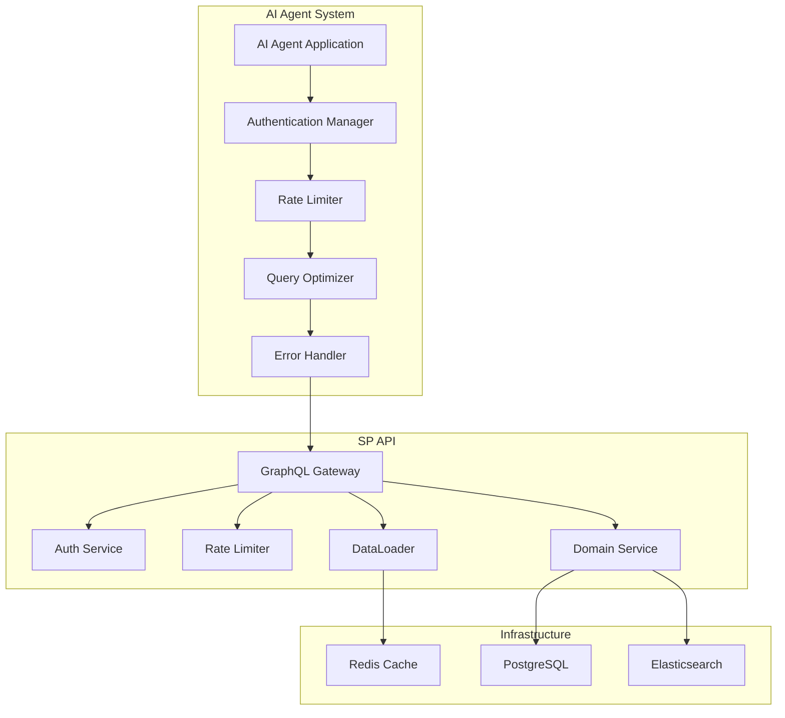

# AIエージェント統合ガイド

## 概要

このガイドでは、AIエージェントがSP APIを効率的に利用するための統合方法について説明します。認証、レート制限、パフォーマンス最適化、エラーハンドリングなどの重要な要素をカバーします。

## アーキテクチャ概要



## 1. 認証の実装

### 1.1 OAuth 2.0 Client Credentials フロー

```python
import requests
import time
from typing import Optional, Dict, Any

class AuthenticationManager:
    def __init__(self, base_url: str, client_id: str, client_secret: str):
        self.base_url = base_url
        self.client_id = client_id
        self.client_secret = client_secret
        self.access_token: Optional[str] = None
        self.expires_at: Optional[float] = None
        self.session = requests.Session()
    
    def get_access_token(self) -> str:
        """アクセストークンを取得または更新"""
        if self._is_token_valid():
            return self.access_token
        
        data = {
            'grant_type': 'client_credentials',
            'client_id': self.client_id,
            'client_secret': self.client_secret,
            'scope': 'events:read teams:read matches:read predictions:read'
        }
        
        response = self.session.post(
            f"{self.base_url}/oauth/token",
            data=data,
            headers={'Content-Type': 'application/x-www-form-urlencoded'}
        )
        
        if response.status_code != 200:
            raise Exception(f"Authentication failed: {response.text}")
        
        token_data = response.json()
        self.access_token = token_data['access_token']
        self.expires_at = time.time() + token_data['expires_in'] - 60  # 1分のマージン
        
        return self.access_token
    
    def _is_token_valid(self) -> bool:
        """トークンが有効かチェック"""
        return (self.access_token is not None and 
                self.expires_at is not None and 
                time.time() < self.expires_at)
```

### 1.2 トークンの自動更新

```python
class APIClient:
    def __init__(self, auth_manager: AuthenticationManager):
        self.auth_manager = auth_manager
        self.session = requests.Session()
    
    def _get_headers(self) -> Dict[str, str]:
        """認証ヘッダーを取得"""
        token = self.auth_manager.get_access_token()
        return {
            'Authorization': f'Bearer {token}',
            'Content-Type': 'application/json'
        }
    
    def execute_query(self, query: str, variables: Optional[Dict[str, Any]] = None) -> Dict[str, Any]:
        """GraphQLクエリを実行"""
        headers = self._get_headers()
        payload = {
            'query': query,
            'variables': variables or {}
        }
        
        response = self.session.post(
            f"{self.auth_manager.base_url}/query",
            json=payload,
            headers=headers
        )
        
        if response.status_code == 401:
            # トークンが無効な場合、再取得してリトライ
            self.auth_manager.access_token = None
            headers = self._get_headers()
            response = self.session.post(
                f"{self.auth_manager.base_url}/query",
                json=payload,
                headers=headers
            )
        
        if response.status_code != 200:
            raise Exception(f"API request failed: {response.status_code} - {response.text}")
        
        return response.json()
```

## 2. レート制限の実装

### 2.1 クライアントサイドレート制限

```python
import time
from collections import defaultdict, deque
from typing import Dict, Deque

class RateLimiter:
    def __init__(self, requests_per_minute: int, requests_per_hour: int, requests_per_day: int):
        self.requests_per_minute = requests_per_minute
        self.requests_per_hour = requests_per_hour
        self.requests_per_day = requests_per_day
        
        self.minute_requests: Deque[float] = deque()
        self.hour_requests: Deque[float] = deque()
        self.day_requests: Deque[float] = deque()
    
    def can_make_request(self) -> bool:
        """リクエストが可能かチェック"""
        now = time.time()
        
        # 古いリクエストを削除
        self._cleanup_old_requests(now)
        
        # 各時間窓での制限をチェック
        if len(self.minute_requests) >= self.requests_per_minute:
            return False
        if len(self.hour_requests) >= self.requests_per_hour:
            return False
        if len(self.day_requests) >= self.requests_per_day:
            return False
        
        return True
    
    def record_request(self) -> None:
        """リクエストを記録"""
        now = time.time()
        self.minute_requests.append(now)
        self.hour_requests.append(now)
        self.day_requests.append(now)
    
    def get_wait_time(self) -> float:
        """次のリクエストまでの待機時間を取得"""
        now = time.time()
        self._cleanup_old_requests(now)
        
        wait_times = []
        
        if len(self.minute_requests) >= self.requests_per_minute:
            wait_times.append(60 - (now - self.minute_requests[0]))
        
        if len(self.hour_requests) >= self.requests_per_hour:
            wait_times.append(3600 - (now - self.hour_requests[0]))
        
        if len(self.day_requests) >= self.requests_per_day:
            wait_times.append(86400 - (now - self.day_requests[0]))
        
        return max(wait_times) if wait_times else 0
    
    def _cleanup_old_requests(self, now: float) -> None:
        """古いリクエストを削除"""
        # 1分前のリクエストを削除
        while self.minute_requests and now - self.minute_requests[0] > 60:
            self.minute_requests.popleft()
        
        # 1時間前のリクエストを削除
        while self.hour_requests and now - self.hour_requests[0] > 3600:
            self.hour_requests.popleft()
        
        # 1日前のリクエストを削除
        while self.day_requests and now - self.day_requests[0] > 86400:
            self.day_requests.popleft()
```

### 2.2 レート制限付きAPIクライアント

```python
import time
from typing import Optional, Dict, Any

class RateLimitedAPIClient:
    def __init__(self, api_client: APIClient, rate_limiter: RateLimiter):
        self.api_client = api_client
        self.rate_limiter = rate_limiter
    
    def execute_query(self, query: str, variables: Optional[Dict[str, Any]] = None) -> Dict[str, Any]:
        """レート制限を考慮してクエリを実行"""
        # レート制限をチェック
        if not self.rate_limiter.can_make_request():
            wait_time = self.rate_limiter.get_wait_time()
            print(f"Rate limit reached. Waiting {wait_time:.2f} seconds...")
            time.sleep(wait_time)
        
        # リクエストを記録
        self.rate_limiter.record_request()
        
        # クエリを実行
        return self.api_client.execute_query(query, variables)
```

## 3. クエリ最適化

### 3.1 クエリコスト計算

```python
class QueryOptimizer:
    def __init__(self):
        self.field_costs = {
            'events': 5,
            'teams': 5,
            'matches': 10,
            'players': 5,
            'participants': 10,
            'members': 5,
            'timelines': 5,
        }
    
    def calculate_complexity(self, query: str) -> int:
        """クエリの複雑さを計算"""
        complexity = 0
        
        for field, cost in self.field_costs.items():
            count = query.count(field)
            complexity += count * cost
        
        return complexity
    
    def optimize_query(self, query: str, max_complexity: int) -> str:
        """クエリを最適化"""
        current_complexity = self.calculate_complexity(query)
        
        if current_complexity <= max_complexity:
            return query
        
        # 複雑さを下げるための最適化
        # 1. 不要なフィールドを削除
        # 2. 深いネストを浅くする
        # 3. フラグメントを使用して重複を削除
        
        return self._simplify_query(query, max_complexity)
    
    def _simplify_query(self, query: str, max_complexity: int) -> str:
        """クエリを簡素化"""
        # 実装例：基本的なフィールドのみを残す
        simplified_fields = ['id', 'name']
        
        # クエリを解析して簡素化
        # 実際の実装では、GraphQLパーサーを使用
        return query  # 簡略化
```

### 3.2 バッチクエリの実装

```python
from typing import List, Dict, Any
import asyncio
import aiohttp

class BatchQueryExecutor:
    def __init__(self, api_client: APIClient, max_concurrent: int = 5):
        self.api_client = api_client
        self.max_concurrent = max_concurrent
        self.semaphore = asyncio.Semaphore(max_concurrent)
    
    async def execute_batch(self, queries: List[Dict[str, Any]]) -> List[Dict[str, Any]]:
        """複数のクエリを並列実行"""
        tasks = []
        for query_data in queries:
            task = self._execute_single_query(query_data)
            tasks.append(task)
        
        results = await asyncio.gather(*tasks, return_exceptions=True)
        return results
    
    async def _execute_single_query(self, query_data: Dict[str, Any]) -> Dict[str, Any]:
        """単一クエリを実行"""
        async with self.semaphore:
            # 非同期HTTPリクエストの実装
            # 実際の実装では、aiohttpを使用
            return await self._async_request(query_data)
    
    async def _async_request(self, query_data: Dict[str, Any]) -> Dict[str, Any]:
        """非同期リクエスト"""
        # aiohttpを使用した実装例
        async with aiohttp.ClientSession() as session:
            async with session.post(
                f"{self.api_client.base_url}/query",
                json=query_data,
                headers=self.api_client._get_headers()
            ) as response:
                return await response.json()
```

## 4. エラーハンドリング

### 4.1 構造化エラーハンドリング

```python
from enum import Enum
from typing import Optional, Dict, Any
import time

class ErrorCode(Enum):
    UNAUTHORIZED = "UNAUTHORIZED"
    INVALID_TOKEN = "INVALID_TOKEN"
    RATE_LIMIT_EXCEEDED = "RATE_LIMIT_EXCEEDED"
    QUERY_COMPLEXITY_EXCEEDED = "QUERY_COMPLEXITY_EXCEEDED"
    VALIDATION_FAILED = "VALIDATION_FAILED"
    INTERNAL_SERVER_ERROR = "INTERNAL_SERVER_ERROR"

class APIError(Exception):
    def __init__(self, code: ErrorCode, message: str, details: Optional[Dict[str, Any]] = None, retry_after: Optional[float] = None):
        self.code = code
        self.message = message
        self.details = details
        self.retry_after = retry_after
        super().__init__(message)

class ErrorHandler:
    def __init__(self, max_retries: int = 3, base_delay: float = 1.0):
        self.max_retries = max_retries
        self.base_delay = base_delay
    
    def handle_error(self, error: APIError, attempt: int) -> bool:
        """エラーを処理し、リトライするかどうかを決定"""
        if attempt >= self.max_retries:
            return False
        
        # リトライ可能なエラーかチェック
        retryable_errors = {
            ErrorCode.RATE_LIMIT_EXCEEDED,
            ErrorCode.INTERNAL_SERVER_ERROR
        }
        
        if error.code not in retryable_errors:
            return False
        
        # 待機時間を計算
        if error.retry_after:
            wait_time = error.retry_after
        else:
            wait_time = self.base_delay * (2 ** attempt)  # 指数バックオフ
        
        print(f"Error {error.code}: {error.message}. Retrying in {wait_time:.2f} seconds...")
        time.sleep(wait_time)
        return True
    
    def parse_graphql_error(self, error_data: Dict[str, Any]) -> APIError:
        """GraphQLエラーを解析"""
        message = error_data.get('message', 'Unknown error')
        extensions = error_data.get('extensions', {})
        code_str = extensions.get('code', 'UNKNOWN')
        
        try:
            code = ErrorCode(code_str)
        except ValueError:
            code = ErrorCode.INTERNAL_SERVER_ERROR
        
        details = extensions.get('details')
        retry_after = extensions.get('retry_after')
        
        return APIError(code, message, details, retry_after)
```

### 4.2 リトライ機能付きAPIクライアント

```python
class ResilientAPIClient:
    def __init__(self, api_client: APIClient, error_handler: ErrorHandler):
        self.api_client = api_client
        self.error_handler = error_handler
    
    def execute_query(self, query: str, variables: Optional[Dict[str, Any]] = None) -> Dict[str, Any]:
        """リトライ機能付きでクエリを実行"""
        last_error = None
        
        for attempt in range(self.error_handler.max_retries + 1):
            try:
                response = self.api_client.execute_query(query, variables)
                
                # GraphQLエラーをチェック
                if 'errors' in response and response['errors']:
                    error_data = response['errors'][0]
                    api_error = self.error_handler.parse_graphql_error(error_data)
                    
                    if self.error_handler.handle_error(api_error, attempt):
                        continue
                    else:
                        raise api_error
                
                return response
            
            except APIError as e:
                last_error = e
                if not self.error_handler.handle_error(e, attempt):
                    break
            
            except Exception as e:
                # 予期しないエラー
                api_error = APIError(ErrorCode.INTERNAL_SERVER_ERROR, str(e))
                if not self.error_handler.handle_error(api_error, attempt):
                    raise e
        
        # 最大リトライ回数に達した場合
        if last_error:
            raise last_error
        else:
            raise APIError(ErrorCode.INTERNAL_SERVER_ERROR, "Max retries exceeded")
```

## 5. キャッシュの実装

### 5.1 クエリ結果のキャッシュ

```python
import json
import hashlib
from typing import Optional, Dict, Any
from datetime import datetime, timedelta

class QueryCache:
    def __init__(self, ttl_seconds: int = 300):  # 5分のTTL
        self.cache: Dict[str, Dict[str, Any]] = {}
        self.ttl_seconds = ttl_seconds
    
    def _generate_key(self, query: str, variables: Optional[Dict[str, Any]] = None) -> str:
        """キャッシュキーを生成"""
        cache_data = {
            'query': query,
            'variables': variables or {}
        }
        cache_str = json.dumps(cache_data, sort_keys=True)
        return hashlib.md5(cache_str.encode()).hexdigest()
    
    def get(self, query: str, variables: Optional[Dict[str, Any]] = None) -> Optional[Dict[str, Any]]:
        """キャッシュから結果を取得"""
        key = self._generate_key(query, variables)
        
        if key not in self.cache:
            return None
        
        cached_item = self.cache[key]
        
        # TTLをチェック
        if datetime.now() > cached_item['expires_at']:
            del self.cache[key]
            return None
        
        return cached_item['data']
    
    def set(self, query: str, data: Dict[str, Any], variables: Optional[Dict[str, Any]] = None) -> None:
        """キャッシュに結果を保存"""
        key = self._generate_key(query, variables)
        expires_at = datetime.now() + timedelta(seconds=self.ttl_seconds)
        
        self.cache[key] = {
            'data': data,
            'expires_at': expires_at
        }
    
    def clear(self) -> None:
        """キャッシュをクリア"""
        self.cache.clear()
```

### 5.2 キャッシュ付きAPIクライアント

```python
class CachedAPIClient:
    def __init__(self, api_client: APIClient, cache: QueryCache):
        self.api_client = api_client
        self.cache = cache
    
    def execute_query(self, query: str, variables: Optional[Dict[str, Any]] = None, use_cache: bool = True) -> Dict[str, Any]:
        """キャッシュを考慮してクエリを実行"""
        if use_cache:
            # キャッシュから取得を試行
            cached_result = self.cache.get(query, variables)
            if cached_result is not None:
                print("Cache hit!")
                return cached_result
        
        # キャッシュにない場合、APIから取得
        result = self.api_client.execute_query(query, variables)
        
        if use_cache and 'data' in result:
            # 成功した場合のみキャッシュに保存
            self.cache.set(query, result, variables)
        
        return result
```

## 6. 完全な統合例

### 6.1 統合されたAIエージェントクライアント

```python
class AIAgentClient:
    def __init__(self, base_url: str, client_id: str, client_secret: str, plan: str = "free"):
        # 認証管理
        self.auth_manager = AuthenticationManager(base_url, client_id, client_secret)
        
        # 基本APIクライアント
        self.api_client = APIClient(self.auth_manager)
        
        # レート制限設定（プランに応じて）
        rate_limits = self._get_rate_limits(plan)
        self.rate_limiter = RateLimiter(**rate_limits)
        
        # レート制限付きクライアント
        self.rate_limited_client = RateLimitedAPIClient(self.api_client, self.rate_limiter)
        
        # エラーハンドリング
        self.error_handler = ErrorHandler(max_retries=3)
        self.resilient_client = ResilientAPIClient(self.rate_limited_client, self.error_handler)
        
        # キャッシュ
        self.cache = QueryCache(ttl_seconds=300)
        self.cached_client = CachedAPIClient(self.resilient_client, self.cache)
        
        # クエリ最適化
        self.query_optimizer = QueryOptimizer()
    
    def _get_rate_limits(self, plan: str) -> Dict[str, int]:
        """プランに応じたレート制限を取得"""
        limits = {
            "free": {"requests_per_minute": 10, "requests_per_hour": 100, "requests_per_day": 1000},
            "standard": {"requests_per_minute": 50, "requests_per_hour": 1000, "requests_per_day": 10000},
            "premium": {"requests_per_minute": 200, "requests_per_hour": 5000, "requests_per_day": 50000},
            "enterprise": {"requests_per_minute": 1000, "requests_per_hour": 50000, "requests_per_day": 500000}
        }
        return limits.get(plan, limits["free"])
    
    def execute_query(self, query: str, variables: Optional[Dict[str, Any]] = None, 
                     use_cache: bool = True, optimize: bool = True) -> Dict[str, Any]:
        """最適化されたクエリを実行"""
        # クエリ最適化
        if optimize:
            max_complexity = self._get_max_complexity()
            query = self.query_optimizer.optimize_query(query, max_complexity)
        
        # キャッシュ付きでクエリを実行
        return self.cached_client.execute_query(query, variables, use_cache)
    
    def _get_max_complexity(self) -> int:
        """プランに応じた最大複雑さを取得"""
        complexities = {
            "free": 50,
            "standard": 200,
            "premium": 1000,
            "enterprise": 5000
        }
        return complexities.get(self.auth_manager.plan, 50)
    
    def get_events(self, limit: int = 10) -> Dict[str, Any]:
        """イベント一覧を取得"""
        query = f"""
            query GetEvents {{
                events {{
                    id
                    name
                    nameJp
                    participants {{
                        id
                        name
                        fifaTrigramme
                    }}
                }}
            }}
        """
        return self.execute_query(query)
    
    def get_team_info(self, fifa_code: str) -> Dict[str, Any]:
        """チーム情報を取得"""
        query = """
            query GetTeam($fifa: String!) {
                team(fifa: $fifa) {
                    id
                    name
                    nameJp
                    fifaTrigramme
                    confederation
                    members {
                        id
                        name
                        number
                        position
                    }
                }
            }
        """
        variables = {"fifa": fifa_code}
        return self.execute_query(query, variables)
```

### 6.2 使用例

```python
# クライアントの初期化
client = AIAgentClient(
    base_url="https://api.example.com",
    client_id="your-client-id",
    client_secret="your-client-secret",
    plan="premium"
)

# イベント一覧の取得
try:
    events = client.get_events(limit=5)
    print("Events:", events['data']['events'])
except APIError as e:
    print(f"API Error: {e.code} - {e.message}")

# チーム情報の取得
try:
    team_info = client.get_team_info("JPN")
    print("Team Info:", team_info['data']['team'])
except APIError as e:
    print(f"API Error: {e.code} - {e.message}")
```

## 7. ベストプラクティス

### 7.1 パフォーマンス最適化

1. **必要なフィールドのみ取得**: 不要なフィールドは取得しない
2. **キャッシュの活用**: 頻繁にアクセスするデータはキャッシュする
3. **バッチクエリ**: 複数のクエリを並列実行する
4. **クエリの最適化**: 複雑さを制限し、効率的なクエリを作成する

### 7.2 エラーハンドリング

1. **構造化エラー**: エラーコードに基づいて適切な処理を行う
2. **リトライ戦略**: 一時的なエラーには指数バックオフでリトライ
3. **ログ記録**: エラーの詳細をログに記録する
4. **フォールバック**: エラー時の代替手段を用意する

### 7.3 セキュリティ

1. **認証情報の保護**: クライアントシークレットを安全に管理
2. **HTTPSの使用**: 本番環境では必ずHTTPSを使用
3. **トークンの管理**: トークンの有効期限を適切に管理
4. **スコープの最小化**: 必要最小限のスコープのみ要求

## 8. トラブルシューティング

### 8.1 よくある問題

**問題**: 認証エラーが頻繁に発生する  
**原因**: トークンの有効期限管理が不適切  
**解決法**: トークンの自動更新機能を実装する

**問題**: レート制限に頻繁に引っかかる  
**原因**: クライアントサイドのレート制限が不適切  
**解決法**: プランに応じた適切なレート制限を設定する

**問題**: クエリの複雑さ制限に引っかかる  
**原因**: 不要に複雑なクエリを作成している  
**解決法**: クエリ最適化機能を使用し、必要なフィールドのみ取得する

### 8.2 デバッグのヒント

1. **ログの活用**: リクエストとレスポンスをログに記録
2. **エラー詳細の確認**: GraphQLエラーの詳細情報を確認
3. **ネットワーク監視**: リクエストのタイミングと頻度を監視
4. **パフォーマンス測定**: レスポンス時間とスループットを測定

## 更新履歴

| バージョン | 日付 | 変更内容 |
|-----------|-----|---------|
| 1.0.0 | 2024-12-19 | 初版 |

---

**作成日**: 2024年12月19日  
**バージョン**: 1.0  
**承認者**: [承認者名]
